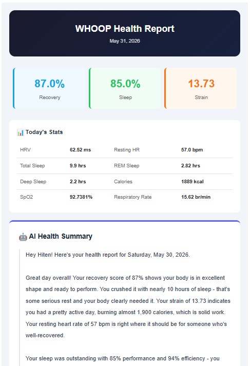

# WHOOP Health Intelligence Agent 🏃

An agentic AI system that automatically fetches daily WHOOP biometric data, combines it with personal daily notes, generates an AI-powered health summary, and emails it every morning.

## Why I Built This

I was working while finishing school, and I wasn't getting enough sleep. I kept waking up during the night and wanted to understand why. I just wanted to check my sleep and recovery each day, but the WHOOP app shows a lot of data I didn't really need, and it felt overwhelming.

WHOOP does have a built-in AI you can chat with, but I found its answers pretty generic. It only sees my WHOOP data, so it can't connect my numbers to what actually happened in my day, and I have to remember to open the app and ask it.

This agent works the other way around:

- **It comes to me.** A short, plain-English report lands in my inbox every morning. No digging through charts.
- **It knows my day.** Every night before bed, I write a quick journal of my day (what I ate, how I felt, stress, water, workouts and anything else that stood out). The agent connects those notes with my recovery, sleep and strain data.
- **It tells me what to change.** Instead of just showing numbers, it points out what likely helped or hurt my sleep and recovery, and what I can do differently tomorrow.

## Demo



## What It Does

- Fetches real-time sleep, recovery, strain and workout data from the WHOOP API
- Reads personal daily notes (food, mood, stress, water intake)
- Uses Claude AI to generate a personalized health summary with recommendations
- Sends a formatted HTML email every morning at 10am
- Automatically refreshes OAuth tokens, so it runs fully on its own with no manual login

## Tech Stack

- **Python:** core agent logic
- **WHOOP API:** biometric data (sleep, recovery, strain)
- **Claude AI by Anthropic:** health summary generation
- **OAuth 2.0:** secure WHOOP authentication
- **Gmail SMTP:** automated email delivery
- **Flask:** OAuth callback server
- **Windows Task Scheduler:** daily automation

## Architecture

```
Daily at 10am (automated)
        ↓
Fetch WHOOP data (sleep + recovery + strain)
        ↓
Read personal notes.txt (food, mood, stress, water)
        ↓
Claude AI generates a personalized health summary
        ↓
HTML email sent automatically
        ↓
notes.txt cleared for the next day
```

## Project Structure

```
whoop-agent/
├── main.py          # Agent orchestrator + OAuth + scheduler
├── whoop.py         # WHOOP API integration
├── ai.py            # Claude AI summary generation
├── email_sender.py  # HTML email formatting + sending
├── .env             # API keys (gitignored)
├── tokens.json      # OAuth tokens (gitignored)
└── notes.txt        # Daily personal notes (gitignored)
```

## Sample Email

The daily email includes:

- Recovery score, HRV, resting heart rate
- Sleep performance, efficiency, consistency
- REM, deep and light sleep breakdown
- Daily strain and calories burned
- AI-generated health summary and recommendations

## Setup

1. Clone the repo
2. Install dependencies:
   ```
   pip install requests anthropic python-dotenv schedule flask
   ```
3. Register an app at developer.whoop.com and get a Client ID and Secret
4. Get a Claude API key at console.anthropic.com
5. Get a Gmail app password at myaccount.google.com
6. Create a `.env` file:
   ```
   WHOOP_CLIENT_ID=your_client_id
   WHOOP_CLIENT_SECRET=your_client_secret
   WHOOP_REDIRECT_URI=http://localhost:5000/callback
   ANTHROPIC_API_KEY=your_claude_key
   GMAIL_ADDRESS=your_gmail
   GMAIL_APP_PASSWORD=your_app_password
   EMAIL_RECIPIENT=your_email
   ```
7. Run to authenticate:
   ```
   python main.py
   ```
8. Schedule with Windows Task Scheduler at your preferred time

## Skills Demonstrated

- REST API integration with OAuth 2.0 authentication
- Agentic AI design and autonomous task execution
- LLM integration (Claude AI)
- Automated data pipelines
- HTML email generation
- Scheduled task automation
